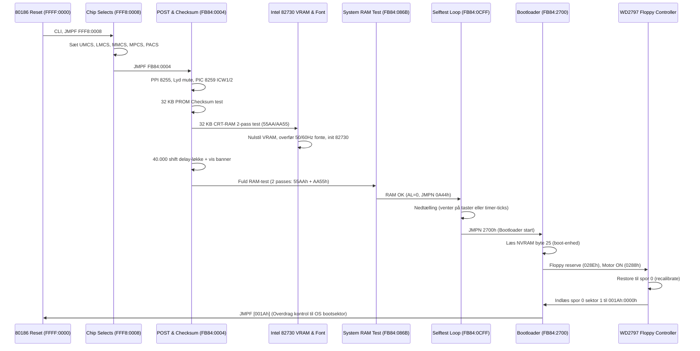

# Reference: RC759 Piccoline Boot PROM (Version 2.1)

Denne reference dokumenterer den komplette arkitektur, hukommelsesmodel, hardware-initialisering og boot-sekvens for Regnecentralen RC759 Piccolines 32 KB Boot PROM (Version 2.1).

* **ROM-fil:** `mame/roms/rc759/rc759-1-2.1.rom` (32.768 bytes)
* **Datamuseum BitStore:** `ROA955.bin` (Even/Low Byte) + `ROA956.bin` (Odd/High Byte), 2x 27128 EPROMs
* **Hashes:** CRC32: `3a777d56`, SHA1: `a8592d61d5e1f92651a6f5e41c4ba14c9b6cc39b`
* **Disassembly:** [`rc759_bootloader_v2.1.asm`](file:///Users/ravn/z80/tasks/rc759-bootprom/rc759_bootloader_v2.1.asm) (10.067 linjer, 100% symbolsk og variabel-beregnet)
* **Generator-værktøj:** [`disassemble_bootrom.py`](file:///Users/ravn/z80/tasks/rc759-bootprom/tools/disassemble_bootrom.py)

---

## 1. Hukommelsesmodel og Dynamisk Segmentberegning

Boot-PROM'en er på 32 KB og er fysisk mappet i toppen af 80186-processorens 1 MB adresseområde:
* **Fysisk adresseområde:** `0xF8000` – `0xFFFFF` (og spejlet ved `0xE8000` – `0xEFFFF`).
* **Hardware Reset-vektor:** 80186 starter ved fysisk `0xFFFF0` (`FFFF:0000h`), svarende til fil-offset `0x7FF0`.

Kildeteksten deklarerer ingen magiske faste hex-segmenttal, men udleder samtlige segmenter, baser og hop via symbolske beregningsformler i headeren:

```asm
ROM_SIZE_BYTES          EQU 08000h                       ; 32 KB Boot PROM
ROM_BASE_PHYSICAL       EQU (0100000h - ROM_SIZE_BYTES)  ; 0F8000h (Toppen af 1 MB CPU-adresserum)
ROM_DATA_SEGMENT        EQU (ROM_BASE_PHYSICAL >> 4)     ; 0F800h (Fuld PROM dækkes fra offset 0000h)

; Datasektion (0000h - 383Bh) og beregning af kodesegment-base via 16-byte paragrafjustering (ALIGN 16)
ROM_DATA_SIZE_BYTES     EQU 0383Ch                       ; Datasektionens faktiske slutning før padding
ROM_CODE_OFFSET         EQU ((ROM_DATA_SIZE_BYTES + 15) & ~15) ; 03840h (Næste paragrafgrænse, ALIGN 16)
ROM_CODE_PHYSICAL       EQU (ROM_BASE_PHYSICAL + ROM_CODE_OFFSET) ; 0FB840h
CODE_SEGMENT_BASE       EQU (ROM_CODE_PHYSICAL >> 4)     ; 0FB84h

; 80186 Reset-stub (initial far jump target fra CPU reset-vektor)
RESET_ENTRY_ROM_OFFSET  EQU 07F88h                       ; 80186 Reset-stub filoffset i PROM
RESET_STUB_PHYSICAL     EQU (ROM_BASE_PHYSICAL + RESET_ENTRY_ROM_OFFSET) ; 0FFF88h
RESET_STUB_IP           EQU 00008h                       ; Entry offset i reset-stub segmentet
RESET_STUB_SEGMENT      EQU ((RESET_STUB_PHYSICAL - RESET_STUB_IP) >> 4) ; 0FFF8h

; 80186 CPU Power-On Reset Vektor (fysisk fastlagt af CPU-arkitekturen til CS:IP = FFFF:0000h)
CPU_RESET_PHYSICAL      EQU 0FFFF0h                      ; CPU Power-on hardware reset entry
RESET_VECTOR_ROM_OFFSET EQU (CPU_RESET_PHYSICAL - ROM_BASE_PHYSICAL) ; 07FF0h (ROM filoffset for reset-vektor)
RESET_VECTOR_SEGMENT    EQU (CPU_RESET_PHYSICAL >> 4)    ; 0FFFFh

; Eksterne hardware- og buffersegmenter
CRT_VRAM_SEGMENT        EQU 0D000h                       ; Intel 82730 VRAM & display-controller styreblok (D000:0000)
LAN_BUFFER_SEGMENT      EQU 03600h                       ; Intel 82586 Ethernet LAN controller buffersegment (3600:0000)
LAN_BUFFER_ALT_SEGMENT  EQU 03000h                       ; Intel 82586 LAN buffer / alternativt testområde (3000:0000)
```

| Segment | Formel / Base | Fil-offset | Formål |
|---|---|---|---|
| **`ROM_DATA_SEGMENT`** | `(ROM_BASE_PHYSICAL >> 4)` = `0F800h` | `0x0000` | **Data-segment:** Alle fonte, tabeller, menutekster og fejlmeddelelser tilgås via `ROM_DATA_SEGMENT:xxxx`, hvor offset `xxxx` svarer til fil-offsettet i ROM'en. |
| **`CODE_SEGMENT_BASE`**| `((ROM_BASE_PHYSICAL + ROM_CODE_OFFSET) >> 4)` = `0FB84h` | `0x3840` | **Hoved-kodesegment:** Al eksekverbar programkode (POST, selftest, CRT-init og bootloader) kører i `FB84h`. Offset i `FB84h` = `fil-offset - 0x3840`. |
| **`RESET_STUB_SEGMENT`**| `((RESET_STUB_PHYSICAL - RESET_STUB_IP) >> 4)` = `0FFF8h` | `0x7F80` | **Reset-stub segment:** Modtager det første far-jump fra reset-vektoren (`RESET_STUB_SEGMENT:reset_entry_fff8_0008` = fil-offset `0x7F88`). |
| **`RESET_VECTOR_SEGMENT`**| `(CPU_RESET_PHYSICAL >> 4)` = `0FFFFh` | `0x7FF0` | **Reset-vektor segment:** CPU reset-vektor (`RESET_VECTOR_SEGMENT:0000h`). |

---

## 2. Fuld Symbolsk Opløsning af Hop, Kald og Tabeller

I kildeteksten findes der **0** uoversatte rå hex-hop eller funktionskald:
1. **1.396 interne hop og funktionskald** er opløst til symbolske labels (alle 622 `CALL` og 774 `JMP / Jcc / LOOP`).
2. **Alle 4 hop-tabeller** (`diag_test_jump_table`, `boot_device_vector_table`, `diag_test_handler_vector_table` og `menu_format_vector_table`) indeholder symbolske funktionspointere.
3. **Indirekte dispatch-kald** (`CALL WORD [ES:DI+diag_test_jump_table]`, `CALL WORD [CS:BX+diag_test_handler_vector_table]`, `CALL WORD [CS:BX+menu_format_vector_table]`) refererer tabellerne ved navn.
4. **Coroutine og returadresse-mønster (DI som retur-register):** Under tidlig koldstart (inden `SS:SP` er konfigureret) kaldes hjælperutiner via `MOV DI, retur_label; JMPS rutine`, hvorefter hjælperen afslutter med `JMP DI`. Alle sådanne rutiner og returadresser er navngivet sigende:
   - SN76494 lyd-dæmpning: [`mute_sn76494_channel`](file:///Users/ravn/z80/tasks/rc759-bootprom/rc759_bootloader_v2.1.asm#L1294) med trin-labels `mute_sound_channel_1`, `mute_sound_channel_2`, `mute_sound_channel_3` og afslutning i `init_interrupt_controllers`.
   - Seriel hex-udskrift: [`serial_tx_hex_word`](file:///Users/ravn/z80/tasks/rc759-bootprom/rc759_bootloader_v2.1.asm#L1455) (konverterer `CX` til 4 ASCII hex-cifre til iSBX) med trin-labels for CRT VRAM fejlrapportering (`post_report_crt_vram_error` m.fl.) og on-screen register-dump (`post_screen_dump_subcode` m.fl.).
5. **Prototype Interrupt Vector Table (`prototype_ivt_table`):** Alle 28 interrupt-vektorer peger direkte på symbolske ISR-labels (`isr_default_trap`, `isr_nmi`, `isr_keyboard_raw`, `isr_fdc_wd2797`, `isr_82730_command_done`, etc.).
6. **Formatering af programflow:** Hvert eneste ubetingede hop og returnering (`JMP`, `JMPS`, `JMPN`, `JMPF`, `RET`, `RETN`, `RETF`, `IRET`) efterfølges af en tom linje, og efterfølgende kode har altid en veldefineret label, så basisblokke og kontrolflow fremstår helt adskilt.
7. **Segment 0000h Scratchpad**: Ombygget fra flade `EQU`s til strukturerede `DB`/`DW`/`TIMES <n> DB 0` datablokke under `SEGMENT RAM_0000 AT 0000h` med alle registrerede controllere og buffere (LAN 82586, FDC WD2797, tastatur, konsol og warm-boot flag).

---

## 3. ROM Layout

```
0000h - 009Dh    (158 B) : Intel 82730 Display Coprocessor initialiseringsblokke
                            - 0005h: SCB (System Configuration Block, 7 bytes -> D000:6000)
                            - 000Ch: CB (General Command Block, 38 bytes -> D000:2000)
                            - 0032h: 50 Hz PAL timing & formatparametre (54 bytes -> D000:2026)
                            - 0068h: 60 Hz NTSC timing & formatparametre (54 bytes -> D000:2026)
009Eh - 01DCh    (319 B) : Specialtegn og grafik-ikoner (tegnkode 01h - 1Fh)
01DDh - 0D3Fh  (2.915 B) : Standard 50 Hz PAL skærmfont (10 scanlines/tegn, 20h - FFh)
0D40h - 2161h  (5.154 B) : Standard 60 Hz NTSC skærmfont (14 scanlines/tegn, 20h - FFh)
2162h - 21D1h    (112 B) : Tastatur-scancode til ASCII opslagstabel
21D2h - 2247h    (118 B) : Fejlmeddelelser for POST (Prom checksum, RAM error, etc.)
2248h - 22B7h    (112 B) : Prototype for Interrupt Vector Table (IVT 0000:0000)
22B8h - 2378h    (193 B) : Snooper monitor / debugger kommando- og prompt-tekster
2379h - 2479h    (257 B) : Skærmbannere og register-udskriftsformater
247Ah - 2608h    (399 B) : Selftest-menu og hardware-konfigurationsparametre
2609h - 26E6h    (222 B) : Diagnostiske test-funktionstabeller
26E7h - 28AFh    (457 B) : Tekster for delsystem-diagnostik (Timer, DMA, 8259, LAN, FDC)
28B0h - 3179h  (2.250 B) : Perifere datastrukturer, FDC kontrolblokke og hjælpetabeller
317Ah - 3347h    (462 B) : Bootloader banner, bootmedie-menu og prompttekster
3348h - 35DFh    (664 B) : Standard OS filnavn ('CCPM    SYS') og netværksfejlmeddelelser
35E0h - 383Fh    (608 B) : Konfigurationsmenu for netværksparametre og maskin-ID
3840h - 3843h      (4 B) : Segment-headere ([CS:0000] = F800h, [CS:0002] = 0000h)
3844h - 7F87h (18.244 B) : KODE: POST, RAM-test, 82730 driver, bootloader
7F88h - 7FDFh     (88 B) : Reset-entry stub: 80186 PCB Chip-Select registeropsætning
7FE0h - 7FEFh     (16 B) : Padding (FFh)
7FF0h - 7FFFh     (16 B) : 80186 Reset-vektor (CLI, JMPF FFF8:0008)
```

---

## 4. Eksekveringssekvens (Cold Boot til CCP/M)



---

## 5. Hardware I/O Port Map

| I/O Port | Enhed | Funktion i Boot-PROM |
|---|---|---|
| `0000h` | 8259A PIC | ICW1 (initialisering: `0x19`) |
| `0002h` | 8259A PIC | ICW2 (vektor-offset `0x20`), OCW1 (interrupt masker) |
| `0020h` | Tastatur | Udlæsning af rå scancodes og tastaturstatus |
| `0056h` | SN76494 Lyd | Dæmpning af de 4 lydkanaler ved boot (`9Fh, BFh, DFh, FFh`) |
| `005Ah` | MM58167 RTC | RTC Data-register |
| `005Ch` | MM58167 RTC | RTC Adresse- og kontrolregister |
| `0070h` | 8255 PPI Port A | Bit 4–5: Hukommelsesstørrelse (256K, 384K, 512K, 640K) |
| `0072h` | 8255 PPI Port B | Bit 6: Monitor-type (0=50Hz, 1=60Hz); Bit 7: Remote debug på iSBX |
| `0074h` | 8255 PPI Port C | Bit 4–5: NVRAM bank switch; Bit 7: Tastatur enable |
| `0076h` | 8255 PPI Kontrol | Konfigurationsord: Mode 0, Port A/B input, Port C output (`0x92`) |
| `0080h–00FFh`| NVRAM | 128 bytes CMOS NVRAM (bank 0–3 styret via port 74h) |
| `0180h–01BFh`| Palette RAM | Skærm-farvepaletter |
| `0230h` | 82730 CRT IRST | Reset af Intel 82730 tekst-coprocessor |
| `0240h` | 82730 CRT CA | Channel Attention puls til 82730 (starter kommando-eksekvering) |
| `0280h–0286h`| WD2797 FDC | Diskettecontroller Status/Command, Track, Sector, Data |
| `0288h` | FDC Kontrol | Bit 0: Drev A/B; Bit 1: Motor 0; Bit 5: DDEN; Bit 6: 1/2MHz ur |
| `028Eh` | Floppy Reserve | Reservering og ack-polling for diskettedrevet |
| `0290h` | Floppy Release | Frigivelse af diskettedrevet |
| `0300h–0316h`| iSBX Slot | Seriel kommunikation (8274 / 8251) ved remote hardware-debug |
| `FFA0h` | 80186 UMCS | Upper Memory Chip Select (`0xF838`: 32 KB boot-ROM) |
| `FFA2h` | 80186 PACS | Peripheral Chip Select (`0x3FF8`: base 0000h) |
| `FFA4h` | 80186 LMCS | Lower Memory Chip Select (`0x003A`: base-RAM) |
| `FFA6h` | 80186 MPCS | Mid-Range Peripheral Chip Select (`0x01F8`) |
| `FFA8h` | 80186 MMCS | Mid-Range Memory Chip Select (`0x90BA`: CRT-RAM D0000h) |

---

## 6. Systemvariabler i RAM (Scratchpad `0000:0000`–`0000:0200`)

| Adresse | Type | Betydning i Boot-PROM |
|---|---|---|
| `0000:0014h` | Byte | Bootloader status (`0xFF` = vellykket bootsektor-load) |
| `0000:0019h` | Byte | Boot-enhed (`0x00` = Drev A, `0x01` = Drev B, `0x04` = Net) |
| `0000:001Ah` | DWord | Hop-adresse til indlæst bootsektor (`JMPF [001Ah]`) |
| `0000:0065h` | Byte | NVRAM validerings-magic (`0xAA`) |
| `0000:0067h` | Byte | Forudvalgt boot-drevbogstav (`'A'`, `'B'`, `'N'`) fra tastatur |
| `0000:0120h` | Byte | Fejlflag for selftest (`0x00` = ingen fejl, `0x01` = PROM fejl, etc.) |
| `0000:0125h` | Word | Beregnet PROM-checksum eller fejlkode |
| `0000:0127h` | Word | Segment for hukommelsesfejl |
| `0000:0121h` | Word | Offset for hukommelsesfejl |
| `0000:012Dh` | Word | **Selftest statusord:** Bit 9 (`0x0200`) er **varmstart-flaget**, der springer RAM-test og nedtælling over! |
| `0000:012Fh` | Byte | Tastatur-modifier tæller (`0x02` når både Ctrl og Alt holdes) |
| `0000:0132h` | Byte | Tastatur hændelsesflag (`0xFF` = ny tast modtaget) |
| `0000:0133h` | Byte | ASCII-værdi af seneste tastetryk |
| `0000:0134h` | Byte | Rå scancode fra tastaturport 20h |
| `0000:0135h` | Word | Timer 0 tick-tæller (inkrementeres af Timer ISR) |

---

## 7. Særlige Tastatur-Genveje og Hotkeys

1. **Afbryd Selftest og Boot Straks (Ctrl + Alt + Backspace):**
   * Implementeret i `FB84:03F6`: Hvis `[012Fh] >= 2` (både Ctrl og Alt er trykket) og scancode `0x0E` (Backspace/Del) modtages, kaldes `FB84:0D28h` $\rightarrow$ `JMPN 2700h`, hvilket øjeblikkeligt afbryder selftest og hopper direkte til bootloaderen.
2. **Forudvælg Drev (Tryk `A` eller `B` under POST):**
   * Implementeret i `FB84:0474`: Tastatur-handleren gemmer tasten i `[0067h]`. Bootloaderen (`2700h`) læser denne adresse og starter direkte på det valgte drev uden at vise menuen.
3. **Selftest Menu (Tryk Mellemrum):**
   * Åbner menuen: `<0>: proceed`, `<1>: list of tests`, `<2>: enter snooper`, `<3>: change parameters`, `<4>: show hardware configuration`.

---

## 8. Fast-Boot Patch (9 bytes til < 0,5 sek. opstart)

For at få Piccolinen i MAME eller på en EPROM til altid at starte lynhurtigt som ved varmstart, patches 4 steder i `rc759-1-2.1.rom`:

```
1. Fil-offset 3D39h: 74 4D       -> EB 4D        (Spring PROM checksum over)
2. Fil-offset 3D88h: FD B8 AA 55 -> E9 21 01 90  (Spring 32 KB CRT-RAM mønstertest over)
3. Fil-offset 406Ch: 74 03       -> 90 90        (Spring 40.000 delay + 384K RAM-test over)
4. Fil-offset 44F8h: 75 6E       -> EB 6E        (Spring selftest menu-nedtælling over)
```
Med dette patch initialiseres al hardware fortsat korrekt, men maskinen booter ethvert operativsystem på under 0,5 sekunder.
