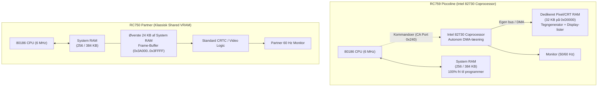

# Skærmarkitektur og -håndtering: RC759 Piccoline vs. RC750 Partner

Dette dokument analyserer de tekniske forskelle i skærmhåndteringen mellem **RC759 Piccoline** og søstermaskinen **RC750 Partner** i Concurrent CP/M-86 3.1 XIOS (`mod4_xios.asm`), samt den historiske og teknologiske rationalisering bag de valgte løsninger.

Konklusionerne er opdelt efter verificeret status:
* **[kendt]**: Verificeret direkte i kildekoden for XIOS (`mod4_xios.asm`), *PICCOLINE Programmer's Guide v2*, hardware-registre og MAME/PCE drivere.
* **[vurderet]**: Historisk, arkitektonisk og forretningsmæssig rationalisering baseret på Regnecentralens produktlinje og 1983–1985 mikrocomputer-teknologi.

---

## 1. Sammenlignende Oversigt

| Parameter | RC759 Piccoline | RC750 Partner | Kilde / Verifikation |
|---|---|---|---|
| **Maskin-ID i Auto-Config** | Ikke `'P'` (typisk `'R'` eller `0x00`) | ASCII `'P'` (`0x50`) ved `0000:0050h` offset `0x17` | **[kendt]** `mod4_xios.asm:16825` |
| **Maskin-ID i NVRAM** | `0xFF` i NVRAM byte 53 (`0x35`) | `0x00` i NVRAM byte 53 (`0x35`) | **[kendt]** *Prog. Guide* s. 20 |
| **Videocoprocessor / CRTC** | **Intel 82730** Text Coprocessor | Diskret CRTC / integreret video-controller | **[kendt]** Hardware-kort & MAME |
| **Placering af skærm-RAM** | **Dedikeret Pixel/CRT-RAM** på `0xD0000`–`0xD7FFF` (32 KB) | **Delt i toppen af system-RAM** | **[kendt]** `mod4_xios.asm:17183` |
| **RAM-fradrag i XIOS (`[cs:0x593d]`)** | **0 KB** (ingen reservation i systemhukommelsen) | **24 KB** (`mov word [cs:0x593d], 0x18`) | **[kendt]** `mod4_xios.asm:17084` |
| **Rullemekanisme (Scroll)** | Både hård linjerulning og **blød scanline-rulning** via `SCROLL.RSP` | Kun hård linjerulning (ingen 82730 scanline-DMA) | **[kendt]** `rsp_scroll.asm` & XIOS |
| **Skærmopdatering / DMA** | Channel Attention (CA) puls via I/O-port `0x0240` | Direkte frame-buffer / systembus opdatering | **[kendt]** `mod4_xios.asm:10508` |
| **Tegnmatrix & Tegngenerator** | 512 programmerbare tegn i RAM (9×14 matrix i 80×25 tekst) | Fast ROM-tegnsæt / standard CRTC-matrix | **[kendt]** *Prog. Guide* s. 53 |
| **Debugger / Afbrydelser** | XIOS overtager **INT 3** (`CS:0x471E`) | XIOS **bevarer INT 1, INT 3 og INT 0xE1** fra Partner ROM | **[kendt]** `mod4_xios.asm:16830-16885` |

---

## 2. Den Tekniske Implementering i XIOS (`mod4_xios.asm`)

XIOS er bygget som en fælles, dynamisk driver for begge maskiner. Under koldstart probes maskintypen én gang, hvorefter to vidt forskellige hardware-stier aktiveres.

### 2.1 Hukommelsesberegning og 24 KB reservation
Når XIOS skal oprette styresystemets hukommelsespartitioner for Concurrent CP/M-86, læses maskinens samlede RAM-størrelse fra bootloaderen (`mod4_xios.asm:17174`):

```assembly
; mod4_xios.asm:17173 (filoffset 0x0C0AF)
loc_0C0AF:
  mov bx, 0x4225                 ; BX peger på Auto-Configuration Map
  les di, [bx]                   ; Indlæs 32-bit total RAM i bytes
  mov ax, es
  shl ax, 6
  shr di, 10
  add ax, di                     ; AX = Samlet systemhukommelse i KB (f.eks. 256 el. 384)
  mov [cs:0x593f], ax            ; Gem total RAM i KB

  mov bx, [cs:0x593d]            ; Hent skærmreservation!
  sub [cs:0x593f], bx            ; Fratræk skærmreservation fra fri hukommelse!
```

* **På Piccoline:** `[cs:0x593d]` initialiseres til `0x0000`. Der fratrækkes **0 KB**. Hvis maskinen har 256 KB RAM, er alle 256 KB til rådighed for CCP/M-86.
* **På Partner:** Hvis maskin-ID er `'P'`, udføres linje 17084:
  ```assembly
  mov word [cs:0x593d], 0x18     ; 0x18 = 24 decimal = 24 KB reservation
  ```
  De øverste 24 KB reserveres til Partnerens skærmbillede, og CCP/M-86 må kun allokere op til `256 - 24 = 232 KB`.

---

### 2.2 Intel 82730 vs. Klassisk Frame-Buffer
Forskellen i hukommelsesreservation skyldes hardwarens opbygning:



1. **Piccolines Intel 82730**:
   * Intel 82730 er en avanceret tekstcoprocessor. Den læser ikke et færdigt bitmap-billede, men eksekverer en **display-liste** af strenge og attributter via egne DMA-cyklusser.
   * Den har sine egne 32 KB RAM på `0xD0000`–`0xD7FFF`. CPU'en behøver kun skrive tekst og attributter her; den rører aldrig systembussen under raster-tegningen.
   * Dette muliggør hardware-features som **blød rulning (smooth scrolling)**: Coprocessoren kan instrueres i at forskyde start-scanlinen for en hel tegnrække via `SCROLL.RSP` og XIOS-kald `INT 0x28, AL=2`.
2. **Partnerens Frame-Buffer**:
   * Partneren benytter en mere traditionel videoarkitektur, hvor skærmen er et direkte hukommelsesmappet frame-buffer i toppen af CPU'ens normale adresserum.
   * For at hardwaren kan hente videodata, må system-RAM deles mellem CPU og videologistik.
   * Der findes ingen 82730 display-liste, og dermed heller ingen understøttelse af `SCROLL.RSP` eller scanline-forskydning. Rulning foregår altid som hård linjerulning (jump scroll) ved at flytte tekstlinjer i hukommelsen.

---

### 2.3 Interrupthåndtering og Debugger-støtte

En anden afgørende forskel er måden, maskinernes afbrydelsesvektorer (IVT) initialiseres på (`mod4_xios.asm:16823-16892`):

```assembly
; 1. Gem Partner-vektorer før IVT renses
mov bx, 0x4225
and byte [bx + 0x17], 0xdf
cmp byte [bx + 0x17], 0x50       ; Er det en Partner ('P')?
jne loc_0BDDA                    ; Nej (Piccoline) -> spring over

; Gem de 3 eksisterende ROM-vektorer:
mov di, 0x5087                   ; Sikkerhedskopi i RAM
mov cx, 3
mov bx, 0x5093                   ; Tabel med offsets: 0x0004 (INT 1), 0x000C (INT 3), 0x0384 (INT 0xE1)
; ... kopierer vektorerne ...

; 2. XIOS initialiserer og renser hele IVT (alle 256 vektorer) med dummy-handler
loc_0BDDA:
; ... fylder 0000:0000 - 0000:03FF ...

; 3. Gendan vektorer på Partner
cmp byte [bx + 0x17], 0x50
jne loc_0BE16
; ... genskriver INT 1, INT 3 og INT 0xE1 ...

; 4. Piccoline-specifik INT 3 handler
loc_0BE16:
cmp byte [bx + 0x17], 0x50
je loc_0BE2F                     ; Partner springer over!
mov di, 0x000c                   ; INT 3 vektor
mov ax, 0x471e                   ; Sæt Piccolines interne breakpoint handler
stosw
stosw
```

* **Partner ('P')**: Partneren var en professionel udviklings- og arbejdsstationsmaskine. Dens bundkort og boot-ROM indeholdt en permanent hardware-/ROM-monitor og in-circuit debugger, der var afhængig af **INT 1** (Single-step) og **INT 3** (Breakpoint). XIOS tager derfor eksplicit hensyn til ikke at ødelægge disse vektorer.
* **Piccoline**: Piccoline var beregnet til skole- og kontorbrug, hvor XIOS selv håndterer software-afbrydelser og fejlfinding for brugerprogrammer. XIOS installerer derfor sin egen breakpoint-handler på INT 3 (`CS:0x471E`).

---

## 3. Vurdering: Hvorfor er det lavet sådan?

Hvorfor har to så nært beslægtede maskiner fra Regnecentralen (begge 80186-baserede fra 1983–1984) to vidt forskellige skærmarkitekturer?

### 3.1 Historisk kontekst og produktlinjer **[vurderet]**
1. **RC750 Partner (1983) — Den mobile arbejdsstation**:
   * Partneren blev designet først. Den var en transportabel arbejdsstation i en kuffert med indbygget 9" CRT-skærm, møntet på professionelle ingeniører, programmører og erhvervslivet.
   * Partneren var bygget til at afløse og supplere **RC702 Piccolo**.
   * Da Partneren blev udviklet, var Intel 82730 tekstprocessoren enten ikke tilgængelig i produktionsmængder eller for dyr/kompleks til formålet. Regnecentralen valgte en gennemprøvet, robust arkitektur: en diskret video-controller, der læser direkte fra de øverste 24 KB af systemets RAM, kombineret med en lynhurtig integreret **Intel 8274 MPSC** seriel controller.
2. **RC759 Piccoline (1984) — "Skolecomputeren" med pædagogisk fokus**:
   * Piccoline blev udviklet specifikt til det danske undervisningsministerium og den store satsning på IT i folkeskolen og gymnasiet.
   * I et undervisningsmiljø var skærmergonomi altafgørende: Elever skulle sidde foran skærmen i timevis. Kravene her var:
     * Højere opløsning (720×350 punkter).
     * Dansk tegnsæt i høj kvalitet (9×14 matrix med rigtige underlængder på 'g', 'j', 'p', 'y' samt æ, ø, å).
     * Matematik- og specialtegn (krævede 512 programmerbare tegn i RAM).
     * **Blød rulning (smooth scrolling)**: I 1984 var hård rulning (hvor teksten hopper en hel linje i ryk) kendt for at give trætte øjne. Ved at vælge Intels helt nye 82730 tekstprocessor kunne Piccoline tilbyde blød, flydende rulning.

### 3.2 Hukommelsesøkonomi i 1984 **[vurderet]**
I 1984 var RAM ekstremt dyrt:
* En standard Piccoline blev leveret med **256 KB RAM** på bundkortet.
* Concurrent CP/M-86 er et ægte multitasking-operativsystem, der kræver plads til:
  * Styresystemkernen (`CCPM.SYS` fylder alene ~78 KB i RAM).
  * Systemtabeller, diskbuffere og køer.
  * Flere samtidige virtuelle konsoller og brugerprogrammer.
* Hvis man stjal **24 KB** fra en 256 KB maskine til skærmen (som på Partner), var der under 150 KB tilbage til brugerens programmer.
* Ved at udstyre Piccoline med **32 KB dedikeret Pixel/CRT-RAM** uden for CPU'ens primære adresserum, bevarede man 100% af de 256 KB system-RAM intakt til multitasking.

### 3.3 Ingeniørmæssig elegance: Ét samlet operativsystem **[kendt/vurderet]**
I stedet for at vedligeholde to separate styresystemer og to XIOS-kildekodetræer til henholdsvis Partner og Piccoline, designede Regnecentralen (med Flemming Kraglund i spidsen) **én universel XIOS**:
* Koden tilpasser sig dynamisk ved opstart via auto-konfigurationsflaget `'P'`.
* Kører den på en Partner, afgiver den 24 KB system-RAM og respekterer maskinens indbyggede debugger.
* Kører den på en Piccoline, aktiverer den Intel 82730 coprocessoren, frigiver al system-RAM til programmer, og kobler `SCROLL.RSP` på til blød rulning.
* Dette sparede Regnecentralen for enorme softwareomkostninger og sikrede, at softwarepakker (som f.eks. RC-Partner/Piccoline integrerede værktøjer) var 100% binært kompatible på tværs af de to platforme.
